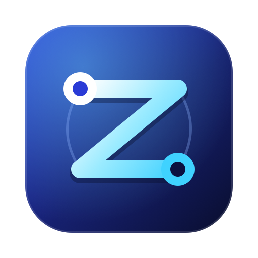
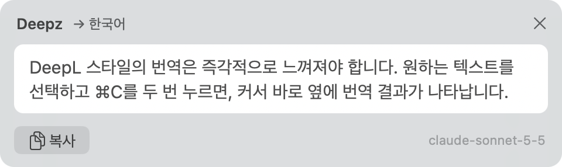

<p align="center">
  
</p>

# Deepz

글을 선택하고 복사 단축키를 **두 번** 누르면 커서 옆에 번역이 뜨는 백그라운드 앱입니다.
DeepL 의 `⌘C, C` 번역에서 영감을 받아 만들었습니다.

- 영어·일본어 등 한국어가 아닌 글 → **한국어**
- 한국어 글 → **영어**
- 번역은 글자가 나오는 대로 바로 보이고(스트리밍), 팝업의 **복사** 버튼으로 결과를 가져갈 수 있습니다.

| 영어 → 한국어 | 한국어 → 영어 |
|---|---|
|  |  |

| | macOS | Windows |
|---|---|---|
| 단축키 | `⌘C`, `C` (⌘ 를 누른 채 C 두 번) | `Ctrl+C`, `C` (Ctrl 을 누른 채 C 두 번) |
| 지원 환경 | macOS 13 이상 | Windows 10 / 11 64비트 |
| 상주 위치 | 메뉴 막대 | 트레이(알림 영역) |
| 구현 | Swift + AppKit (`mac/`) | Rust + Win32 API (`windows/`) |
| 키 파일 | `~/Library/Application Support/Deepz/env` | `%APPDATA%\Deepz\env` |

> **준비물은 API 키 하나입니다.** Deepz 는 Claude · OpenAI · Gemini 중 하나의 API 로 번역합니다.
> 키는 앱이나 이 저장소에 들어 있지 않으며, 각자 컴퓨터의 키 파일에서만 읽습니다. → [2. API 키 설정](#2-api-키-설정)

## 목차

1. [설치](#1-설치)
2. [API 키 설정](#2-api-키-설정)
3. [사용법](#3-사용법)
4. [메뉴](#4-메뉴)
5. [모델 바꾸기](#5-모델-바꾸기)
6. [문제 해결](#6-문제-해결)
7. [개인정보](#7-개인정보)
8. [삭제](#8-삭제)
9. [개발](#9-개발)

## 1. 설치

### macOS

소스에서 빌드합니다. 스크립트 하나가 빌드·설치·실행까지 합니다.

1. 터미널에서 Xcode Command Line Tools 를 설치합니다 (이미 있으면 건너뜁니다).

   ```sh
   xcode-select --install
   ```

2. 저장소를 받아 빌드 스크립트를 실행합니다.

   ```sh
   git clone https://github.com/izowooi/crispy-app.git
   cd crispy-app/deepz
   ./mac/build.sh
   ```

3. `설치 및 실행 완료: ~/Applications/Deepz.app` 이 나오면 끝입니다.
   메뉴 막대 오른쪽에 **Z 모양 아이콘**이 생깁니다. Dock 에는 나타나지 않습니다.

`deepz/.env.local` 파일에 키를 미리 적어 두면 빌드 스크립트가 키 파일 위치로 복사해 줍니다 (없어도 됩니다. 설치 후 메뉴에서 넣을 수 있습니다).

> 직접 빌드한 앱은 ad-hoc 서명입니다. 다른 사람이 만든 `Deepz.app` 을 받아서 쓰는 경우 macOS 가 실행을 막을 수 있습니다.
> 그때는 Finder 에서 앱을 **우클릭 → 열기** 로 한 번 실행하거나, `xattr -dr com.apple.quarantine ~/Applications/Deepz.app` 을 실행합니다.

### Windows

`Deepz.exe` 파일 하나가 전부입니다. 설치 과정이 없습니다.

1. `Deepz.exe` 를 준비합니다.
   - [Releases](https://github.com/izowooi/crispy-app/releases) 에 Deepz 빌드가 있으면 받습니다.
   - 없으면 [9. 개발](#9-개발) 의 방법으로 직접 빌드합니다 (`dist/Deepz.exe` 가 만들어집니다).
2. 원하는 폴더(예: `C:\Tools\Deepz\`)에 두고 더블클릭합니다.
   - "Windows 의 PC 보호" 창이 뜨면 **추가 정보 → 실행** 을 누릅니다 (코드 서명이 없는 실행 파일이라 나오는 안내입니다).
3. 화면 오른쪽 아래 트레이에 **Z 모양 아이콘**이 생깁니다. 안 보이면 `^` (숨겨진 아이콘 표시)를 눌러 봅니다.

## 2. API 키 설정

### 2-1. 키 발급

아래 중 **하나만** 있으면 됩니다. 여러 개를 넣으면 위에서부터 순서대로 쓰고, 실패하면 다음 것으로 넘어갑니다.

| 순서 | 서비스 | 키 발급 | 키 파일에 적는 이름 |
|---|---|---|---|
| 1 | Claude (Anthropic) | <https://console.anthropic.com/settings/keys> | `ANTHROPIC_API_KEY` |
| 2 | OpenAI | <https://platform.openai.com/api-keys> | `OPENAI_API_KEY` |
| 3 | Gemini (Google) | <https://aistudio.google.com/apikey> | `GEMINI_API_KEY` |

API 는 사용한 만큼 요금이 나옵니다. 요금은 각 서비스의 콘솔에서 확인합니다.

### 2-2. 키 파일에 넣기

1. 메뉴 막대(macOS) 또는 트레이(Windows)의 Deepz 아이콘을 누릅니다.
2. **API 키 설정…** 을 누릅니다. 키 파일이 텍스트 편집기(macOS) / 메모장(Windows)으로 열립니다. 파일이 없으면 아래 틀로 새로 만들어 줍니다.

   ```
   # Deepz API 키. 하나만 있어도 됩니다. 저장하면 다음 번역부터 적용됩니다.
   ANTHROPIC_API_KEY=
   OPENAI_API_KEY=
   GEMINI_API_KEY=
   ```

3. 가지고 있는 키를 `=` 뒤에 붙여 넣고 **저장**합니다. 안 쓰는 줄은 비워 두면 됩니다.

   ```
   ANTHROPIC_API_KEY=sk-ant-여기에-본인-키
   ```

4. 앱을 다시 켤 필요 없이 **다음 번역부터 바로 적용**됩니다.

직접 파일을 만들어도 됩니다. 위치는 다음과 같습니다.

| | 키 파일 위치 |
|---|---|
| macOS | `~/Library/Application Support/Deepz/env` |
| Windows | `%APPDATA%\Deepz\env` (또는 `Deepz.exe` 와 같은 폴더의 `.env.local`) |

참고

- 한 줄에 `이름=값` 하나씩 적습니다. 값을 따옴표로 감싸도 되고, `#` 으로 시작하는 줄은 무시합니다.
- 이름은 다음 표기도 받습니다: Claude `CLAUDE_API_KEY` `CLAUDE_KEY` / OpenAI `OPEN_AI_KEY` `OPENAI_KEY` / Gemini `GEMINI_KEY` `GOOGLE_API_KEY`.
- 키 파일은 비밀번호처럼 다룹니다. 채팅방·이슈·커밋에 붙여 넣지 않습니다. 이 저장소는 `.env*` 파일을 커밋하지 않도록 설정되어 있습니다.

## 3. 사용법

1. 아무 앱(브라우저, PDF, 메신저, 편집기…)에서 번역할 글을 마우스로 선택합니다.
2. **macOS**: `⌘` 를 누른 채 `C` 를 빠르게 두 번 누릅니다. **Windows**: `Ctrl` 을 누른 채 `C` 를 두 번 누릅니다 (두 번 사이 간격 0.6초 이내).
3. 마우스 커서 옆에 팝업이 뜨고 번역이 흘러나옵니다.
4. 팝업에서 할 수 있는 것
   - **복사** 버튼: 번역 결과를 클립보드에 복사
   - 번역 결과 일부를 드래그로 선택해 복사
   - 머리줄을 끌어서 팝업 이동
   - 닫기: `X` 버튼, 팝업 바깥 클릭, 또는 (팝업을 클릭한 뒤) `Esc`

알아 둘 점

- 번역 방향은 자동입니다. 글자의 절반 이상이 한글이면 영어로, 아니면 한국어로 번역합니다.
- 한 번에 20,000자까지 번역합니다.
- 복사 단축키를 그대로 쓰기 때문에, 선택한 글은 평소처럼 클립보드에도 복사됩니다.
- 팝업 오른쪽 아래에 이번 번역에 쓴 모델 이름이 표시됩니다.

## 4. 메뉴

Deepz 아이콘을 누르면 나오는 메뉴입니다.


| 항목 | 설명 |
|---|---|
| 일시 정지 | 체크하면 단축키를 눌러도 번역하지 않습니다. 다시 누르면 풀립니다. |
| 정밀 감지 켜기 (손쉬운 사용 권한)… | macOS 전용. 아래 설명 참고. 권한을 주면 이 항목은 사라집니다. |
| API 키 설정… | 키 파일을 엽니다. |
| 로그인 시 자동 실행 / Windows 시작 시 자동 실행 | 컴퓨터를 켤 때 Deepz 를 자동으로 실행합니다. |
| Deepz 종료 | 앱을 끝냅니다. |

### macOS 감지 방식 두 가지

Deepz 는 권한 없이도 동작합니다. 메뉴 둘째 줄에 지금 쓰는 방식이 표시됩니다.

| 방식 | 권한 | 동작 |
|---|---|---|
| 클립보드 (기본) | 필요 없음 | 같은 글이 연달아 두 번 복사되면 `⌘C, C` 로 봅니다. |
| 키 입력 (정밀) | 손쉬운 사용 | `⌘C` 키 입력 자체를 봅니다. DeepL 과 같은 방식입니다. |

클립보드 방식은 대부분의 앱에서 잘 되지만, 같은 내용을 다시 복사해도 클립보드를 갱신하지 않는 일부 앱에서는 반응하지 않을 수 있습니다. 그럴 때 정밀 감지를 켭니다.

1. 메뉴에서 **정밀 감지 켜기 (손쉬운 사용 권한)…** 을 누릅니다.
2. macOS 안내 창에서 **시스템 설정 열기** 를 누릅니다.
3. **개인정보 보호 및 보안 → 손쉬운 사용** 목록에서 **Deepz** 를 켭니다.
4. 몇 초 안에 메뉴의 감지 방식이 **키 입력 (정밀)** 으로 바뀝니다. 앱을 다시 켤 필요는 없습니다.

> `./mac/build.sh` 로 앱을 다시 빌드하면 서명이 바뀌어 이 권한이 풀릴 수 있습니다. 그때는 손쉬운 사용 목록에서 Deepz 를 `−` 로 지운 뒤 다시 켭니다.

## 5. 모델 바꾸기

기본 모델과 시도 순서입니다.

1. `claude-sonnet-5-5` (effort medium)
2. `gpt-6.2-sol` (reasoning effort medium)
3. `gemini-4-hydrogen` (thinking 끔)

키 파일에 아래 줄을 추가하면 모델을 바꿀 수 있습니다.

```
DEEPZ_CLAUDE_MODEL=claude-haiku-5-5
DEEPZ_OPENAI_MODEL=...
DEEPZ_GEMINI_MODEL=...
```

## 6. 문제 해결

| 증상 | 확인할 것 |
|---|---|
| 팝업에 `API 키를 찾지 못했습니다` | 키 파일이 없거나 이름이 다릅니다. 메뉴의 **API 키 설정…** 으로 열어 `ANTHROPIC_API_KEY=키` 형식인지 확인합니다. |
| `… 오류 (HTTP 401)` | 키가 틀렸거나 폐기됐습니다. 앞뒤 공백·줄바꿈 없이 다시 붙여 넣습니다. |
| `… 오류 (HTTP 429)` / 요금 관련 메시지 | 사용량 한도 또는 잔액 문제입니다. 해당 서비스 콘솔을 확인합니다. |
| `… 오류 (HTTP 404)` 등 모델 관련 메시지 | 키 파일의 `DEEPZ_*_MODEL` 값이 그 키로 쓸 수 있는 모델인지 확인합니다. |
| 단축키를 눌러도 아무 반응이 없음 (macOS) | ① 메뉴에서 **일시 정지** 가 꺼져 있는지 ② C 두 번을 0.6초 안에 눌렀는지 ③ 그래도 안 되면 [정밀 감지](#macos-감지-방식-두-가지)를 켭니다. |
| 단축키를 눌러도 아무 반응이 없음 (Windows) | 관리자 권한으로 실행 중인 프로그램 안에서는 일반 권한의 Deepz 가 키 입력을 볼 수 없습니다. Deepz 도 관리자 권한으로 실행하면 됩니다. |
| 메뉴 막대에 아이콘이 없음 (macOS) | 메뉴 막대가 꽉 차면 아이콘이 가려집니다. 다른 아이콘을 줄이거나 `open ~/Applications/Deepz.app` 으로 다시 실행합니다. |
| 비밀번호 관리자에서 복사한 글이 번역되지 않음 | 의도한 동작입니다. 숨김 표시된 클립보드 항목은 읽지 않습니다. |

터미널에서 키와 네트워크만 따로 점검할 수 있습니다 (macOS).

```sh
~/Applications/Deepz.app/Contents/MacOS/Deepz --translate "Hello, world"
# 안녕하세요, 세계
# [claude-sonnet-5-5]
```

## 7. 개인정보

- 번역할 때 **선택한 글이 해당 API 제공사(Anthropic / OpenAI / Google)로 전송**됩니다. 그 밖의 서버는 거치지 않습니다.
- `⌘C, C` / `Ctrl+C, C` 를 눌렀을 때만 전송합니다. 평소의 복사 내용이나 키 입력은 저장하거나 보내지 않습니다.
- 비밀번호 관리자가 숨김으로 표시한 클립보드 항목은 읽지 않습니다.
- 번역 기록은 어디에도 저장하지 않습니다.

## 8. 삭제

macOS

```sh
pkill -x Deepz
rm -rf ~/Applications/Deepz.app "$HOME/Library/Application Support/Deepz"
```

로그인 시 자동 실행을 켰다면 삭제 전에 메뉴에서 끄거나, **시스템 설정 → 일반 → 로그인 항목** 에서 지웁니다.

Windows: 트레이 메뉴에서 **Windows 시작 시 자동 실행** 을 끄고 **Deepz 종료** 를 누른 뒤, `Deepz.exe` 와 `%APPDATA%\Deepz` 폴더를 지웁니다.

## 9. 개발

```
deepz/
├── assets/icon.svg          아이콘 원본
├── scripts/make-icons.swift icon.svg → mac/AppIcon.icns, windows/icon.ico, assets/icon.png
├── mac/                     macOS 앱 (Swift 파일 하나)
└── windows/                 Windows 앱 (Rust). core.rs 는 플랫폼과 무관한 번역 로직
```

| 작업 | 명령 |
|---|---|
| macOS 빌드·설치·실행 | `./mac/build.sh` |
| Windows 실행 파일 빌드 (macOS 에서 크로스 컴파일) | `./windows/build.sh` → `dist/Deepz.exe` |
| 테스트 | `cd windows && cargo test` |
| 아이콘 다시 만들기 | `swift scripts/make-icons.swift` |

Windows 빌드에 필요한 것 (macOS 기준, 처음 한 번)

```sh
rustup target add x86_64-pc-windows-gnu
brew install mingw-w64
```

Windows 에서 직접 빌드하려면 Rust(MSVC 또는 GNU 툴체인)를 설치하고 `windows/` 에서 `cargo build --release` 를 실행합니다.

## 라이선스

[MIT](../LICENSE)
