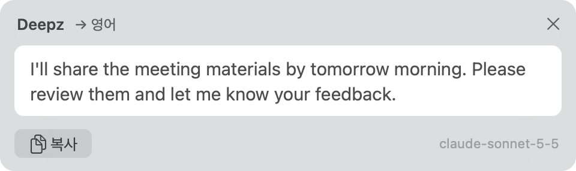
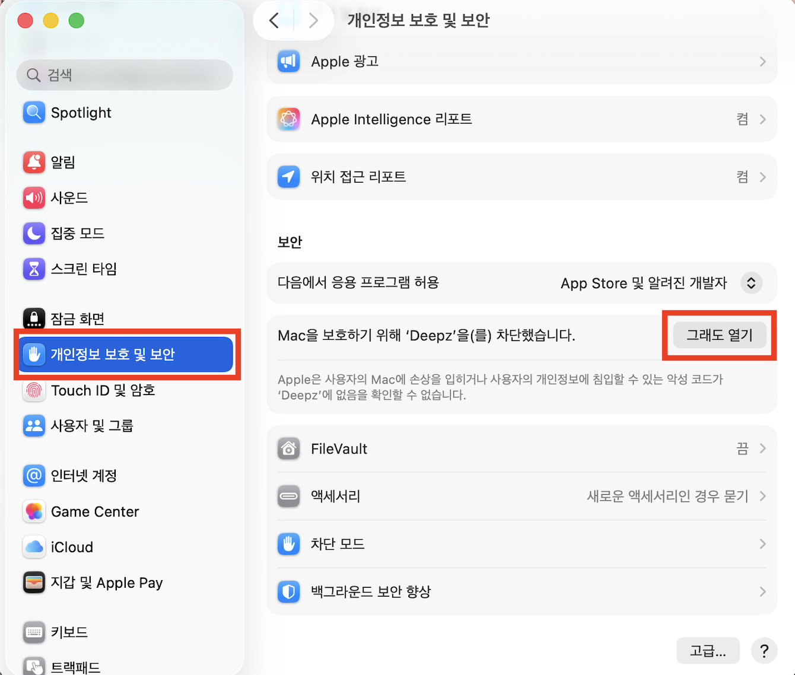
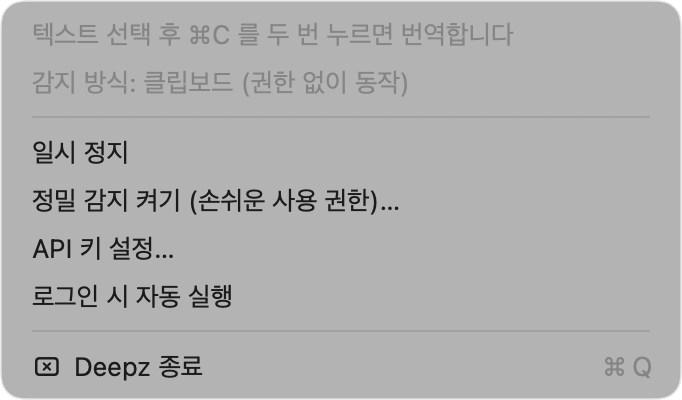
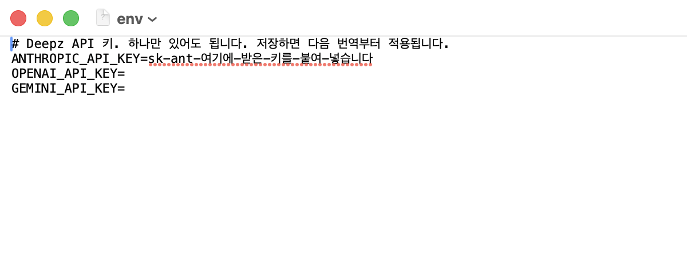

<p align="center">
  
</p>

# Deepz

글을 선택하고 복사 단축키를 **두 번** 누르면 커서 옆에 번역이 뜨는 앱입니다.
DeepL 의 `⌘C, C` 번역에서 영감을 받아 만들었습니다.

- 영어·일본어 등 한국어가 아닌 글 → **한국어**
- 한국어 글 → **영어**

| 영어 → 한국어 | 한국어 → 영어 |
|---|---|
|  |  |

## 3단계로 시작하기

| | 할 일 | 걸리는 시간 |
|---|---|---|
| 1 | [앱을 받아서 실행합니다](#1-설치) — [macOS](#macos) · [Windows](#windows) | 2분 |
| 2 | [API 키를 넣습니다](#2-api-키-넣기) | 1분 |
| 3 | [글을 선택하고 `⌘C` `C` (Windows 는 `Ctrl+C` `C`)](#3-사용법) | — |

**받는 곳: [Deepz 1.0.0 다운로드](https://github.com/izowooi/crispy-app/releases/tag/deepz-v1.0.0)**

| 내 컴퓨터 | 받을 파일 |
|---|---|
| Mac (macOS 13 이상, Apple Silicon·Intel 모두) | `Deepz-1.0.0-macOS-universal.zip` |
| Windows 10 / 11 (64비트) | `Deepz-1.0.0-windows-x64.zip` |

## 1. 설치

### macOS

1. 위 다운로드 페이지에서 `Deepz-1.0.0-macOS-universal.zip` 을 받습니다.
2. 다운로드 폴더에서 zip 을 더블클릭해 풉니다. `Deepz` 앱이 나옵니다.
3. `Deepz` 를 **응용 프로그램** 폴더로 끌어다 놓습니다.
4. 응용 프로그램 폴더에서 `Deepz` 를 더블클릭합니다.
5. **처음 한 번만** macOS 가 실행을 막습니다. *"Apple 은 'Deepz' 에 … 악성 코드가 없음을 확인할 수 없습니다"* 창이 뜨면 **완료** 를 누릅니다 (휴지통으로 이동을 누르지 않습니다).
6. **Apple 메뉴 → 시스템 설정 → 개인정보 보호 및 보안** 을 열고 맨 아래로 내립니다. *"'Deepz' 이(가) 차단되었습니다"* 옆의 **그래도 열기** 를 누르고, 한 번 더 **그래도 열기** → Mac 암호(또는 Touch ID)를 입력합니다.

   

7. 화면 맨 위 메뉴 막대 오른쪽에 **Z 모양 아이콘**이 생기면 설치 끝입니다. Dock 에는 나타나지 않습니다.

> 왜 막히나요? Deepz 는 Apple 의 유료 공증을 받지 않은 앱이라 처음 열 때 한 번 확인을 거칩니다. 두 번째 실행부터는 묻지 않습니다.
>
> 6번이 번거로우면 터미널 앱을 열고 아래 한 줄을 붙여 넣어도 됩니다. 그 뒤 Deepz 를 다시 더블클릭합니다.
>
> ```sh
> /usr/bin/xattr -dr com.apple.quarantine /Applications/Deepz.app
> ```

### Windows

1. 위 다운로드 페이지에서 `Deepz-1.0.0-windows-x64.zip` 을 받습니다.
2. zip 을 우클릭 → **압축 풀기** 로 풉니다. 푼 폴더를 원하는 곳(예: `문서\Deepz`)에 둡니다.
3. 폴더 안의 `Deepz.exe` 를 더블클릭합니다.
4. *"Windows 의 PC 보호"* 파란 창이 뜨면 **추가 정보** → **실행** 을 누릅니다 (코드 서명이 없는 프로그램이라 처음 한 번 나오는 안내입니다).
5. 화면 오른쪽 아래 트레이에 **Z 모양 아이콘**이 생기면 끝입니다. 안 보이면 `^` (숨겨진 아이콘 표시)를 눌러 봅니다.

   

설치 프로그램이 없습니다. `Deepz.exe` 를 실행하면 켜지고, 트레이 메뉴의 **Deepz 종료** 로 꺼집니다.

## 2. API 키 넣기

Deepz 는 번역에 AI 서비스(Claude · OpenAI · Gemini)를 씁니다. 그래서 **API 키**라는 긴 암호 같은 글자가 하나 필요합니다. 키는 앱에 들어 있지 않고, 각자 컴퓨터에 한 번만 넣으면 됩니다.

- **동호회 회원**: 운영자에게 받은 키를 그대로 씁니다.
- **그 밖의 분**: [키 직접 발급받기](#키-직접-발급받기)를 먼저 봅니다.

### 넣는 방법

1. 메뉴 막대(Mac) 또는 트레이(Windows)의 **Z 아이콘**을 누르고 **API 키 설정…** 을 누릅니다.

   

2. 메모장 같은 창이 열립니다. 받은 키에 맞는 줄의 `=` **바로 뒤에** 키를 붙여 넣습니다. 띄어쓰기 없이 붙입니다.

   | 받은 키의 모양 | 붙여 넣을 줄 |
   |---|---|
   | `sk-ant-…` 로 시작 | `ANTHROPIC_API_KEY=` |
   | `sk-proj-…` 등 그 밖의 `sk-…` | `OPENAI_API_KEY=` |
   | `AIza…` 로 시작 | `GEMINI_API_KEY=` |

   

3. 저장합니다 (Mac `⌘S`, Windows `Ctrl+S`). 창은 닫아도 됩니다.
4. 끝입니다. 앱을 다시 켤 필요 없이 다음 번역부터 적용됩니다.

키를 여러 개 받았다면 해당하는 줄에 모두 넣습니다. 위에서부터 순서대로 쓰고, 하나가 실패하면 다음 것으로 넘어갑니다. 안 쓰는 줄은 비워 둡니다.

> **키는 비밀번호처럼 다룹니다.** 단체 채팅방·게시판·스크린샷에 올리지 않습니다. 키가 퍼지면 다른 사람이 쓴 요금까지 청구됩니다.

### 키 직접 발급받기

아래 중 하나만 있으면 됩니다. 발급은 무료이고, 번역한 만큼 요금이 나옵니다.

| 서비스 | 키 발급 페이지 |
|---|---|
| Claude (Anthropic) | <https://console.anthropic.com/settings/keys> |
| OpenAI | <https://platform.openai.com/api-keys> |
| Gemini (Google) | <https://aistudio.google.com/apikey> |

## 3. 사용법

1. 아무 앱(브라우저, PDF, 메신저, 문서…)에서 번역할 글을 마우스로 선택합니다.
2. 복사 단축키를 **빠르게 두 번** 누릅니다.
   - Mac: `⌘` 를 누른 채 `C` 두 번
   - Windows: `Ctrl` 을 누른 채 `C` 두 번
3. 마우스 커서 옆에 팝업이 뜨고 번역이 나옵니다.

   

팝업에서 할 수 있는 것

- **복사** 버튼: 번역 결과를 복사합니다.
- 번역 결과의 일부만 드래그해서 복사할 수 있습니다.
- 팝업 윗부분을 끌면 옮길 수 있습니다.
- 닫기: `X` 버튼을 누르거나 팝업 바깥을 클릭합니다.

알아 둘 점

- 번역 방향은 자동입니다. 한글이 절반 이상이면 영어로, 아니면 한국어로 번역합니다.
- 한 번에 20,000자까지 번역합니다.
- 선택한 글은 평소처럼 클립보드에도 복사됩니다.
- 컴퓨터를 켤 때마다 자동으로 켜지게 하려면 메뉴에서 **로그인 시 자동 실행**(Mac) / **Windows 시작 시 자동 실행** 을 누릅니다.

## 4. (Mac, 선택) 손쉬운 사용 권한

**대부분은 이 단계가 필요 없습니다.** Deepz 는 권한 없이도 동작합니다.
단축키를 눌러도 반응하지 않는 앱이 있을 때만 켭니다.

1. Z 아이콘 → **정밀 감지 켜기 (손쉬운 사용 권한)…** 을 누릅니다.
2. macOS 안내 창에서 **시스템 설정 열기** 를 누릅니다.
3. **개인정보 보호 및 보안 → 손쉬운 사용** 목록에서 **Deepz** 스위치를 켭니다.

   

4. 몇 초 뒤 메뉴 둘째 줄이 **감지 방식: 키 입력 (정밀)** 로 바뀌면 된 것입니다. 앱을 다시 켤 필요는 없습니다.

| 감지 방식 | 권한 | 동작 |
|---|---|---|
| 클립보드 (기본) | 필요 없음 | 같은 글이 연달아 두 번 복사되면 번역합니다. |
| 키 입력 (정밀) | 손쉬운 사용 | `⌘C` 키 입력 자체를 봅니다. DeepL 과 같은 방식입니다. |

> 새 버전으로 바꾸면 이 권한이 풀릴 수 있습니다. 그때는 손쉬운 사용 목록에서 Deepz 를 선택해 `−` 로 지운 뒤 1번부터 다시 합니다.

## 5. 메뉴

| 항목 | 설명 |
|---|---|
| 일시 정지 | 체크하면 단축키를 눌러도 번역하지 않습니다. 다시 누르면 풀립니다. |
| 정밀 감지 켜기 (손쉬운 사용 권한)… | Mac 전용. [4번](#4-mac-선택-손쉬운-사용-권한) 참고. 권한을 주면 이 항목은 사라집니다. |
| API 키 설정… | 키 파일을 엽니다. |
| 로그인 시 자동 실행 / Windows 시작 시 자동 실행 | 컴퓨터를 켤 때 Deepz 를 자동으로 실행합니다. |
| Deepz 종료 | 앱을 끝냅니다. |

## 6. 문제 해결

| 증상 | 해결 |
|---|---|
| 팝업에 `API 키를 찾지 못했습니다` | 키를 아직 안 넣었거나 줄 이름이 다릅니다. [2. API 키 넣기](#2-api-키-넣기)를 다시 따라 합니다. |
| `… 오류 (HTTP 401)` | 키가 틀렸습니다. 앞뒤에 빈칸이나 줄바꿈이 섞이지 않게 다시 붙여 넣고 저장합니다. |
| `… 오류 (HTTP 429)` 또는 요금·한도 메시지 | 사용량 한도나 잔액 문제입니다. 키를 준 사람(동호회 운영자)에게 알립니다. |
| 단축키를 눌러도 반응이 없음 (Mac) | ① 메뉴에서 **일시 정지** 가 꺼져 있는지 ② `C` 두 번을 빠르게(0.6초 안에) 눌렀는지 확인합니다. ③ 그래도 안 되면 [손쉬운 사용 권한](#4-mac-선택-손쉬운-사용-권한)을 켭니다. |
| 단축키를 눌러도 반응이 없음 (Windows) | 트레이에 Z 아이콘이 있는지 확인합니다. 관리자 권한으로 실행한 프로그램 안에서는 동작하지 않습니다. `Deepz.exe` 를 우클릭 → **관리자 권한으로 실행** 하면 됩니다. |
| Z 아이콘이 안 보임 (Mac) | 메뉴 막대가 꽉 차면 가려집니다. 다른 아이콘을 줄이거나 Deepz 를 다시 실행합니다. |
| "Deepz 은(는) 손상되었기 때문에 열 수 없습니다" (Mac) | [설치](#macos)의 터미널 한 줄(`/usr/bin/xattr …`)을 실행한 뒤 다시 엽니다. |
| 비밀번호 관리자에서 복사한 글이 번역되지 않음 | 의도한 동작입니다. 숨김 표시된 항목은 읽지 않습니다. |

## 7. 개인정보

- 번역할 때 **선택한 글이 해당 AI 서비스(Anthropic / OpenAI / Google)로 전송**됩니다. 그 밖의 서버는 거치지 않습니다.
- 단축키를 두 번 눌렀을 때만 전송합니다. 평소의 복사 내용이나 키 입력은 저장하거나 보내지 않습니다.
- 비밀번호 관리자가 숨김으로 표시한 클립보드 항목은 읽지 않습니다.
- 번역 기록은 어디에도 저장하지 않습니다.

## 8. 업데이트와 삭제

**업데이트**: 새 버전 zip 을 받아 같은 자리에 덮어씁니다. 먼저 메뉴에서 **Deepz 종료** 를 누릅니다. 넣어 둔 키는 그대로 남습니다.

**삭제**

- Mac: 메뉴에서 **로그인 시 자동 실행** 을 끄고 **Deepz 종료** → 응용 프로그램 폴더의 `Deepz` 를 휴지통에 넣습니다. 키 파일까지 지우려면 Finder 에서 `⇧⌘G` 를 누르고 `~/Library/Application Support/Deepz` 를 입력해 그 폴더를 지웁니다.
- Windows: 트레이 메뉴에서 **Windows 시작 시 자동 실행** 을 끄고 **Deepz 종료** → `Deepz.exe` 가 든 폴더를 지웁니다. 키 파일까지 지우려면 탐색기 주소창에 `%APPDATA%\Deepz` 를 입력해 그 폴더를 지웁니다.

---

## 고급 설정

### 키 파일

**API 키 설정…** 이 여는 파일의 위치입니다. 직접 만들어도 됩니다.

| | 위치 |
|---|---|
| macOS | `~/Library/Application Support/Deepz/env` |
| Windows | `%APPDATA%\Deepz\env` (또는 `Deepz.exe` 와 같은 폴더의 `.env.local`) |

- 한 줄에 `이름=값` 하나씩 적습니다. 값을 따옴표로 감싸도 되고, `#` 으로 시작하는 줄은 무시합니다.
- 이름은 다음 표기도 받습니다: Claude `CLAUDE_API_KEY` `CLAUDE_KEY` / OpenAI `OPEN_AI_KEY` `OPENAI_KEY` / Gemini `GEMINI_KEY` `GOOGLE_API_KEY`.

### 모델 바꾸기

기본 모델과 시도 순서입니다.

1. `claude-sonnet-5-5` (effort medium)
2. `gpt-6.2-sol` (reasoning effort medium)
3. `gemini-4-hydrogen` (thinking 끔)

키 파일에 아래 줄을 추가하면 바꿀 수 있습니다.

```
DEEPZ_CLAUDE_MODEL=claude-haiku-5-5
DEEPZ_OPENAI_MODEL=...
DEEPZ_GEMINI_MODEL=...
```

### 터미널에서 점검 (macOS)

```sh
/Applications/Deepz.app/Contents/MacOS/Deepz --translate "Hello, world"
# 안녕하세요, 세계
# [claude-sonnet-5-5]
```

## 개발

소스에서 직접 빌드하려는 분을 위한 내용입니다. 쓰기만 할 분은 읽지 않아도 됩니다.

```
deepz/
├── assets/icon.svg          아이콘 원본
├── scripts/make-icons.swift icon.svg → mac/AppIcon.icns, windows/icon.ico, assets/icon.png
├── scripts/package.sh       배포용 ZIP 만들기
├── mac/                     macOS 앱 (Swift 파일 하나)
└── windows/                 Windows 앱 (Rust). core.rs 는 플랫폼과 무관한 번역 로직
```

| 작업 | 명령 |
|---|---|
| macOS 빌드·설치(`~/Applications`)·실행 | `./mac/build.sh` |
| Windows 실행 파일 빌드 (macOS 에서 크로스 컴파일) | `./windows/build.sh` → `dist/Deepz.exe` |
| 배포용 ZIP 두 개와 SHA-256 | `./scripts/package.sh` → `dist/` |
| 테스트 | `cd windows && cargo test` |
| 아이콘 다시 만들기 | `swift scripts/make-icons.swift` |

준비물 (macOS, 처음 한 번)

```sh
xcode-select --install
rustup target add x86_64-pc-windows-gnu
brew install mingw-w64
```

`deepz/.env.local` 에 키를 적어 두면 `./mac/build.sh` 가 키 파일 위치로 복사합니다. `.env*` 파일은 커밋되지 않습니다.

macOS 앱은 ad-hoc 서명이며 Developer ID 서명·Apple 공증을 포함하지 않습니다. Windows 실행 파일은 코드 서명되지 않았습니다.

## 라이선스

[MIT](../LICENSE). Windows 배포 ZIP 의 `licenses/` 폴더에 포함된 Rust 크레이트의 라이선스 고지가 들어 있습니다.
