<p align="center">
  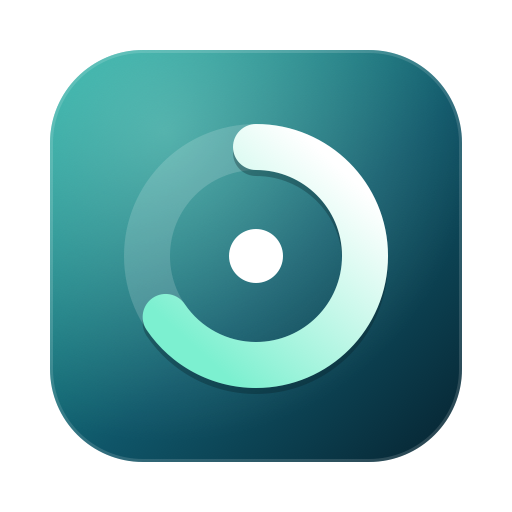
</p>

# DiskLens

디스크나 폴더를 고르면 **무엇이 용량을 차지하는지 한 장의 그림으로** 보여 주는 앱입니다.
큰 네모일수록 큰 파일입니다. 네모를 누르면 그 폴더 안으로 들어갑니다.
보기만 합니다. 파일을 지우거나 옮기지 않습니다.

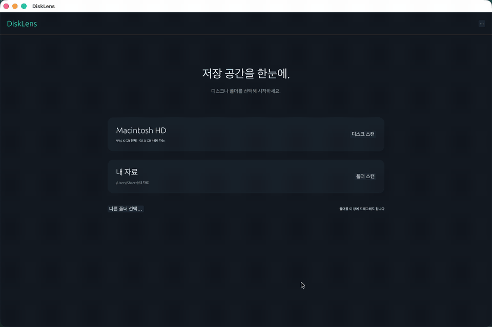

<sub>움직이지 않으면 [원본 영상(mp4)](docs/clips/demo.mp4)을 봅니다.</sub>

## 3단계로 시작하기

| | 할 일 | 걸리는 시간 |
|---|---|---|
| 1 | [앱을 받아서 실행합니다](#1-설치) — [macOS](#macos) · [Windows](#windows) | 2분 |
| 2 | [디스크나 폴더를 골라 스캔합니다](#2-스캔하기) | 몇 초 ~ 몇 분 |
| 3 | [큰 네모부터 눌러 봅니다](#3-결과-보기) | — |

**받는 곳: [DiskLens 1.0.3 다운로드](https://github.com/izowooi/crispy-app/releases/tag/disk-lens-v1.0.3)**

| 내 컴퓨터 | 받을 파일 |
|---|---|
| Mac (Apple Silicon — M1 이후, macOS 12 이상) | `DiskLens-1.0.3-macOS-arm64.zip` |
| Windows 10 / 11 (64비트) | `DiskLens-1.0.3-windows-x64.zip` |

### 직접 다운로드판과 App Store 판

DiskLens 는 두 가지로 나옵니다. **여기서 받는 직접 다운로드판이 기능이 전부 들어 있는 쪽입니다.** Mac App Store 판은 Apple 의 샌드박스 규칙 때문에 몇 가지를 뺐고, 스토어에서는 이름이 **DiskZ** 입니다 (`DiskLens` 는 이미 있는 이름이라 쓸 수 없었습니다. 심사 준비 중입니다).

| | 직접 다운로드판 DiskLens (이 페이지) | Mac App Store 판 DiskZ |
|---|---|---|
| 디스크 전체 스캔 | **디스크 스캔** 한 번 | **디스크 선택…** 을 누르고, 열리는 창에서 **열기** 를 한 번 더 눌러야 합니다 |
| 보호된 폴더(메일, 사진 보관함 등) | 전체 디스크 접근 권한을 켜면 읽습니다 | 읽지 못합니다 |
| 지난번에 본 폴더 | 기억했다가 **폴더 스캔** 으로 바로 엽니다 | 켤 때마다 다시 고릅니다 |
| 터미널에서 쓰기 (`--scan`) | 됩니다 | 안 됩니다 |
| Windows | 됩니다 | 없습니다 (Mac 전용) |
| 설치 | 처음 한 번 "그래도 열기" 가 필요합니다 | App Store 에서 받으면 끝 |
| 업데이트 | 새 zip 을 직접 받습니다 | 자동 |

차트, 폴더 이동, 항목 찾기, Finder 에서 보기는 두 판이 같습니다. 디스크를 통째로 자주 본다면 직접 다운로드판을 권합니다.

## 1. 설치

### macOS

1. 위 다운로드 페이지에서 `DiskLens-1.0.3-macOS-arm64.zip` 을 받습니다.
2. 다운로드 폴더에서 zip 을 더블클릭해 풉니다. `DiskLens` 앱이 나옵니다.
3. `DiskLens` 를 **응용 프로그램** 폴더로 끌어다 놓고, 거기서 더블클릭합니다.
4. **처음 한 번만** macOS 가 실행을 막습니다. *"'DiskLens'을(를) 열지 않음"* 창이 뜨면 **완료** 를 누릅니다. **휴지통으로 이동은 누르지 않습니다.**

   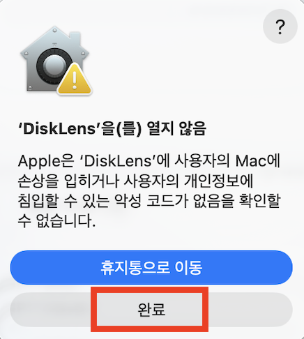

5. **Apple 메뉴 → 시스템 설정 → 개인정보 보호 및 보안** 을 열고 아래로 내려 **보안** 부분을 봅니다. *"Mac을 보호하기 위해 'DiskLens'을(를) 차단했습니다."* 옆의 **그래도 열기** 를 누릅니다.

   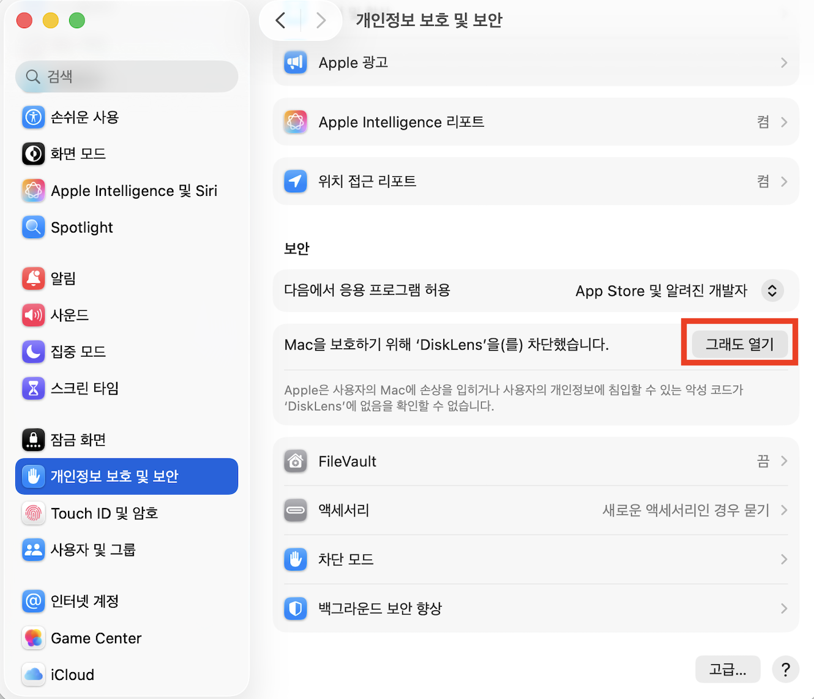

6. *"'DiskLens'을(를) 열겠습니까?"* 창이 뜨면 가운데의 **그래도 열기** 를 누르고, Mac 암호(또는 Touch ID)를 입력합니다.

   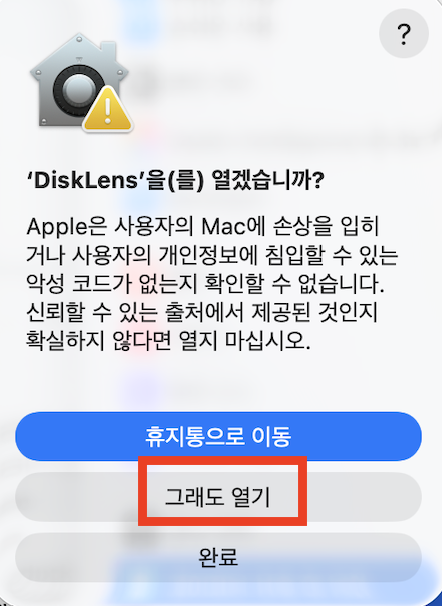

7. 아래 창이 뜨면 설치 끝입니다.

   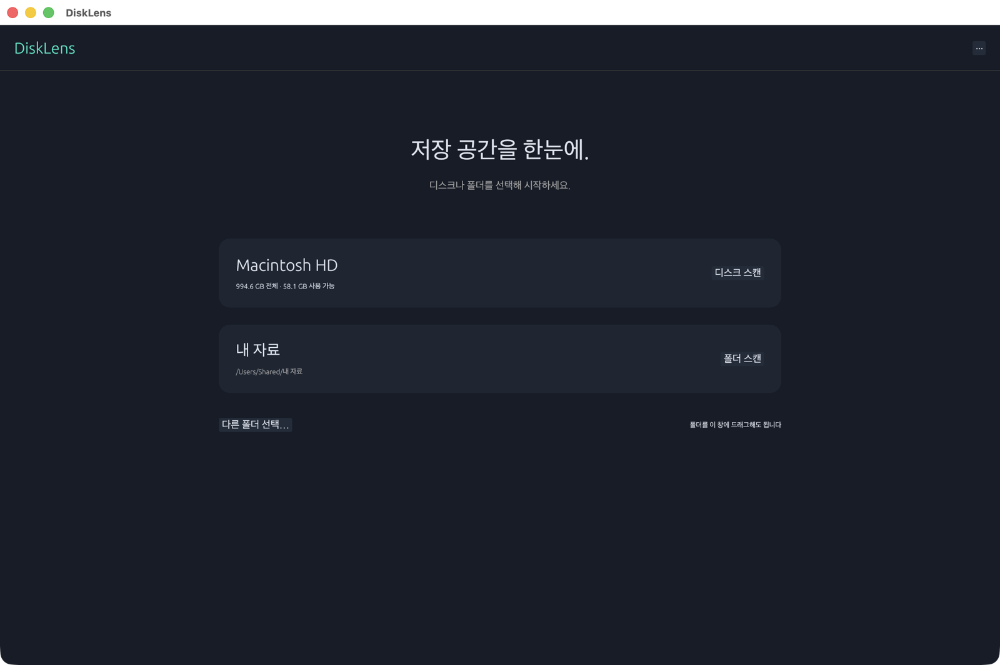

> 왜 막히나요? DiskLens 는 Apple 의 공증을 받지 않은 앱이라 처음 열 때 한 번 확인을 거칩니다. 두 번째 실행부터는 묻지 않습니다.
>
> 4~6번이 번거로우면 터미널 앱을 열고 아래 한 줄을 붙여 넣어도 됩니다. 그 뒤 DiskLens 를 다시 더블클릭합니다.
>
> ```sh
> /usr/bin/xattr -dr com.apple.quarantine /Applications/DiskLens.app
> ```

### Windows

1. 위 다운로드 페이지에서 `DiskLens-1.0.3-windows-x64.zip` 을 받습니다.
2. zip 을 우클릭 → **압축 풀기** 로 풉니다. 푼 폴더를 원하는 곳(예: `문서\DiskLens`)에 둡니다.
3. 폴더 안의 `DiskLens.exe` 를 더블클릭합니다.
4. *"Windows 의 PC 보호"* 파란 창이 뜨면 **추가 정보** → **실행** 을 누릅니다 (코드 서명이 없는 프로그램이라 처음 한 번 나오는 안내입니다).

   

5. DiskLens 창이 뜨면 끝입니다.

설치 프로그램이 없습니다. `DiskLens.exe` 를 실행하면 켜지고, 창을 닫으면 꺼집니다.

## 2. 스캔하기

첫 화면에서 볼 곳을 고릅니다. 앱을 켜는 것만으로는 아무것도 스캔하지 않습니다.


| 하고 싶은 것 | 누를 것 |
|---|---|
| 컴퓨터 전체를 본다 | **디스크 스캔** |
| 아래 칸에 적힌 폴더를 본다 (지난번에 본 폴더가 기억됩니다) | **폴더 스캔** |
| 다른 폴더나 외장 디스크를 본다 | **다른 폴더 선택…** — 또는 폴더를 창에 끌어다 놓습니다 |

- 폴더 하나는 보통 몇 초, 디스크 전체는 파일 수에 따라 몇 분 걸립니다.
- 스캔 중에는 아래쪽에 지금까지 확인한 용량과 항목 수가 나옵니다. 오른쪽 위 **중지** 를 누르면 거기까지의 결과를 보여 줍니다.
- 처음에는 **다운로드** 나 **문서** 같은 폴더 하나로 해 보는 것이 빠릅니다.

### (Mac, 선택) 전체 디스크 접근 권한

**폴더 하나만 볼 때는 필요 없습니다.** 디스크 전체를 스캔했는데 *"일부 폴더를 읽지 못했습니다"* 가 나올 때만 켭니다. macOS 가 메일·사진 보관함 같은 보호된 폴더를 앱에 보여 주지 않아서 생기는 일입니다.

1. 오른쪽 위 **···** → **전체 디스크 접근 권한…** 을 누릅니다.

   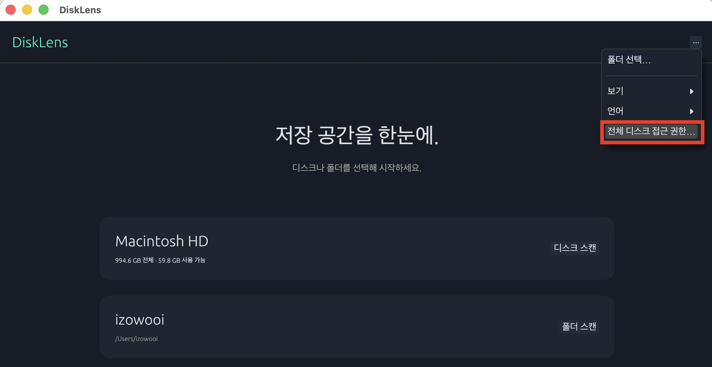

2. 안내 창에서 **설정 열기** 를 누릅니다. 시스템 설정의 **전체 디스크 접근 권한** 목록이 바로 열립니다.

   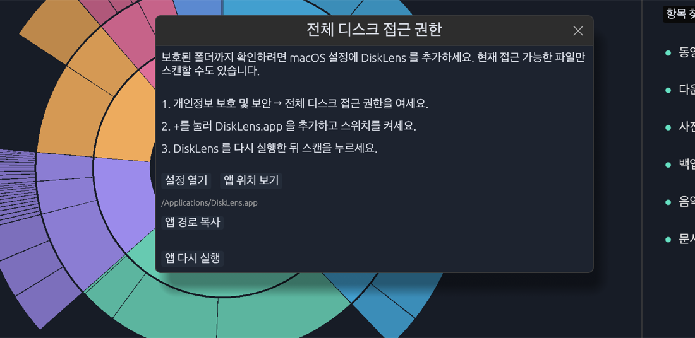

   > 직접 찾아가도 됩니다: **Apple 메뉴 → 시스템 설정 → 개인정보 보호 및 보안**(아래 그림의 ①) **→ 전체 디스크 접근 권한**.

3. 목록 아래의 **+**(②)를 누르고, **응용 프로그램** 에서 **DiskLens**(③)를 고른 뒤 **열기**(④)를 누릅니다. Mac 암호(또는 Touch ID)를 물으면 입력합니다.

   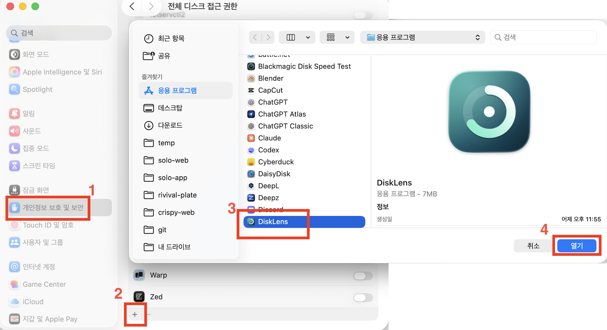

4. *"'DiskLens'은(는) 종료될 때까지 전체 디스크 접근 권한이 없습니다."* 창이 뜨면 **종료 및 다시 열기** 를 누릅니다. 창이 뜨지 않으면 DiskLens 의 안내 창에서 **앱 다시 실행** 을 누릅니다.

   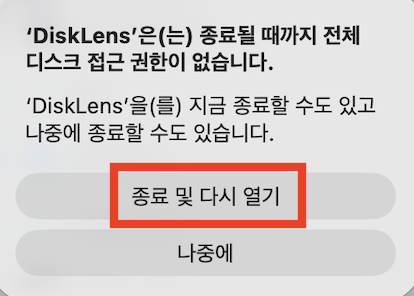

5. 다시 **디스크 스캔** 을 누릅니다.

Windows 에는 이 단계가 없습니다.

## 3. 결과 보기

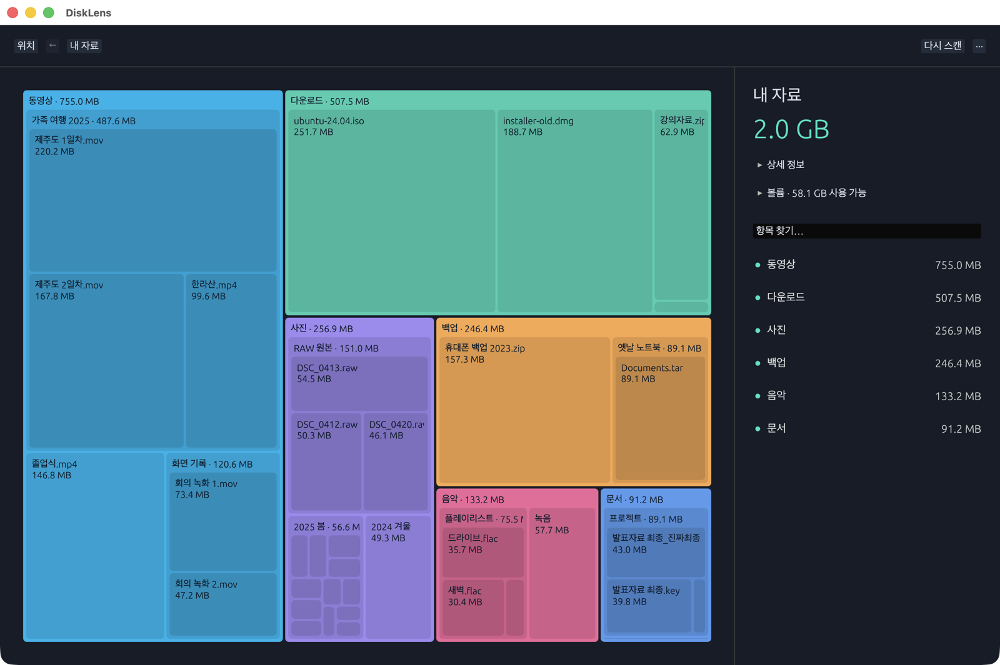

**왼쪽 그림(트리맵)** — 네모 하나가 파일이나 폴더 하나이고, 넓이가 용량입니다. 같은 색은 같은 폴더입니다.

**오른쪽 목록** — 지금 보고 있는 폴더의 내용을 큰 순서로 보여 줍니다. 맨 위 숫자가 이 폴더의 전체 용량입니다.

| 하고 싶은 것 | 방법 |
|---|---|
| 폴더 안으로 들어간다 | 그림에서 폴더를 누릅니다. 또는 목록에서 더블클릭합니다. |
| 한 단계 전으로 돌아간다 | 왼쪽 위 **←** |
| 위쪽 폴더로 바로 간다 | 왼쪽 위에 나란히 있는 폴더 이름을 누릅니다. |
| 이름으로 찾는다 | 오른쪽 **항목 찾기…** 칸에 입력합니다. |
| 다른 곳을 스캔한다 | 왼쪽 위 **위치** |
| 방금 정리한 결과를 다시 본다 | 오른쪽 위 **다시 스캔** |

폴더를 누르면 그 폴더만 크게 펼쳐집니다.

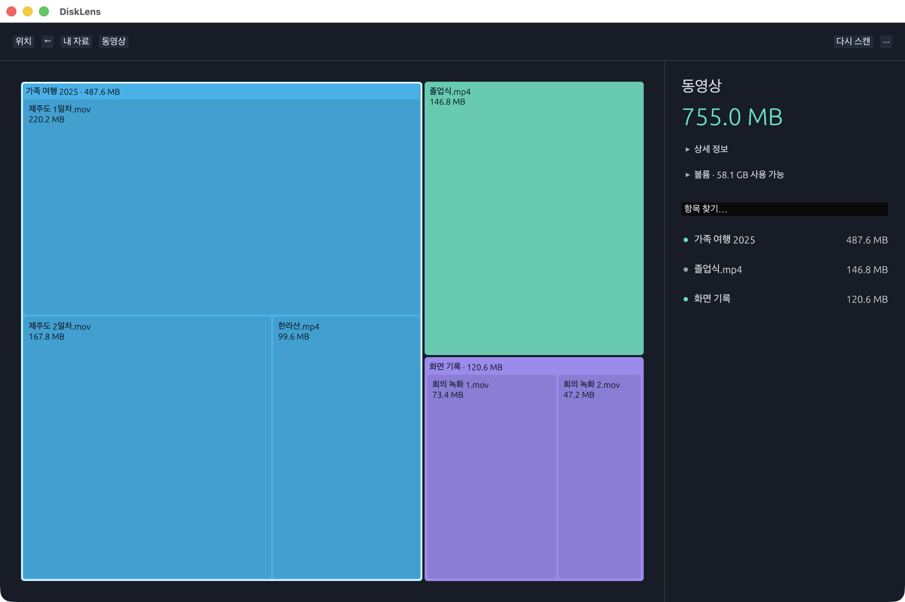

### 파일이 어디 있는지 찾기

오른쪽의 **상세 정보** 를 펼치면 선택한 항목의 전체 경로, 파일 수, 스캔 시간이 나옵니다.

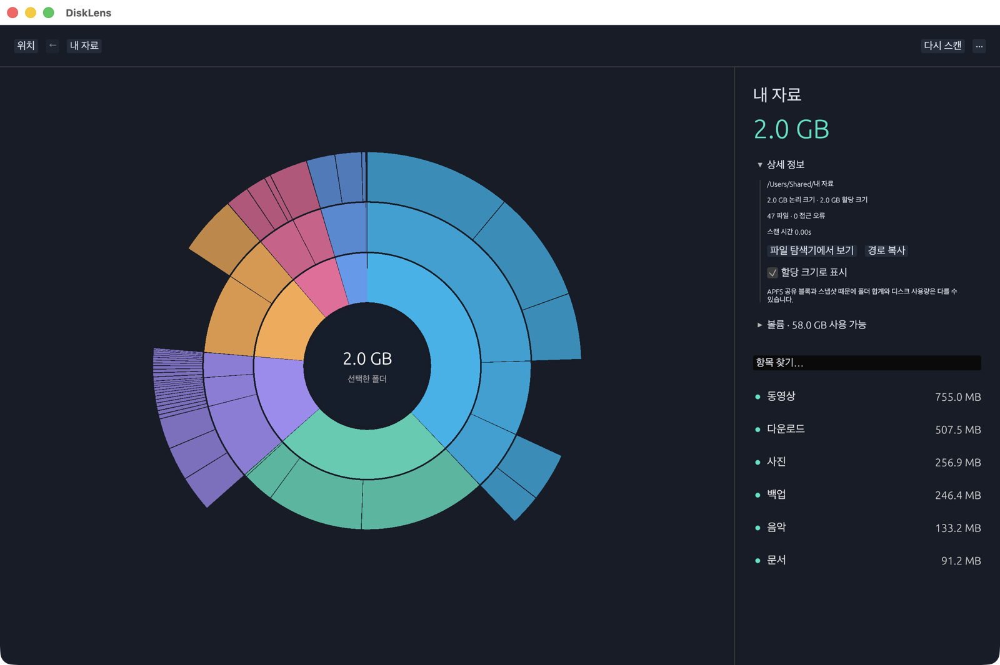

- **파일 탐색기에서 보기** — Finder(Windows 는 탐색기)에서 그 항목을 열어 줍니다. 지우려면 거기서 직접 지웁니다. **DiskLens 는 아무것도 지우지 않습니다.**
- **경로 복사** — 경로를 클립보드에 복사합니다.
- **할당 크기로 표시** — 켜 두면 디스크에서 실제로 차지하는 크기, 끄면 파일에 적힌 크기(논리 크기)로 봅니다. 보통은 켠 채로 둡니다.

### 방사형 차트

오른쪽 위 **···** → **보기** → **방사형** 을 누르면 같은 내용을 원으로 봅니다. 가운데가 지금 폴더이고, 바깥 고리로 갈수록 더 안쪽 폴더입니다. 가운데를 누르면 위 폴더로 올라갑니다.

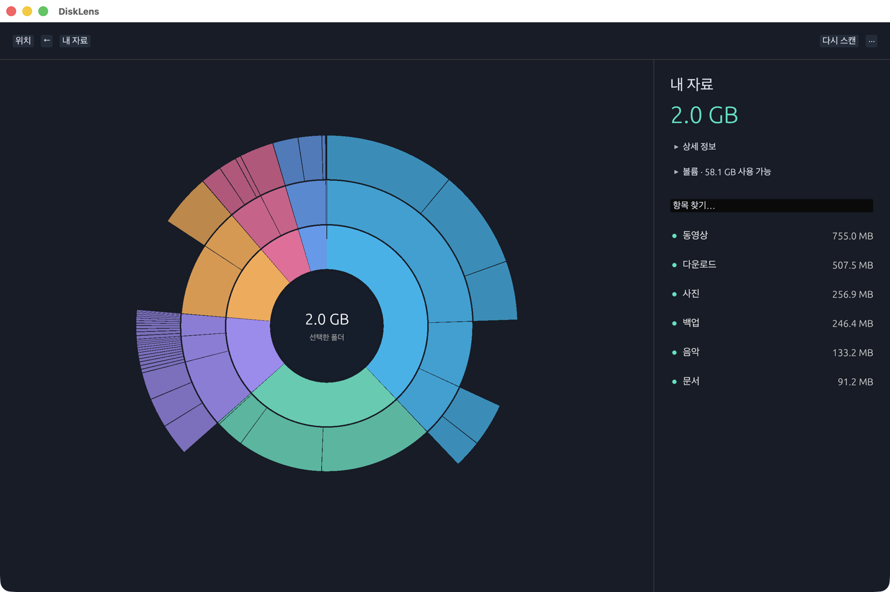

## 4. 메뉴

오른쪽 위 **···** 를 누르면 나옵니다.

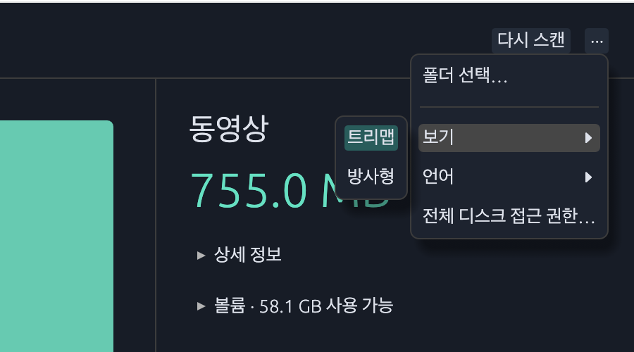

| 항목 | 하는 일 |
|---|---|
| 폴더 선택… | 스캔할 폴더를 고릅니다. |
| 보기 | 트리맵 / 방사형. 고른 것이 다음 실행에도 유지됩니다. |
| 언어 | English / 한국어 / 简体中文 / 日本語 / Deutsch / Français / Italiano / Español / العربية / Polski / Русский |
| 전체 디스크 접근 권한… | Mac 에만 있습니다. → [위 설명](#mac-선택-전체-디스크-접근-권한) |

## 5. 문제 해결

| 증상 | 해결 |
|---|---|
| Mac 에서 "열지 않음" 창만 뜨고 실행이 안 됩니다 | [설치의 4~6번](#macos)을 합니다. |
| *"일부 폴더를 읽지 못했습니다"* | Mac 은 [전체 디스크 접근 권한](#mac-선택-전체-디스크-접근-권한)을 켭니다. Windows 는 다른 사용자의 폴더나 시스템 폴더라 읽지 못한 것으로, 그 부분만 합계에서 빠집니다. |
| 합계가 Finder 나 탐색기에 나오는 디스크 사용량과 다릅니다 | 정상입니다. 스냅샷, 여러 파일이 함께 쓰는 공간, 읽지 못한 폴더는 폴더 합계에 다르게 잡힙니다. DiskLens 의 숫자는 "이 폴더를 지우면 대략 이만큼 줄어든다"의 기준으로 봅니다. |
| 스캔이 너무 오래 걸립니다 | **중지** 를 누르면 그때까지의 결과가 나옵니다. 디스크 전체 대신 의심되는 폴더만 스캔합니다. |
| iCloud·OneDrive 폴더가 생각보다 작게 나옵니다 | 내려받지 않은 파일은 이 컴퓨터의 용량을 차지하지 않아서 작게 나옵니다. |
| 바로가기(심볼릭 링크) 폴더가 0 으로 나옵니다 | 링크는 따라가지 않습니다. 원래 폴더를 직접 고릅니다. |
| 다른 언어로 보고 싶습니다 | **···** → **언어** 에서 고릅니다. 처음 켤 때는 컴퓨터의 언어 설정을 따릅니다 |

## 6. 개인정보

- DiskLens 는 인터넷에 연결하지 않습니다. 파일 이름과 크기는 이 컴퓨터 밖으로 나가지 않습니다.
- 파일의 **이름과 크기만** 읽습니다. 파일 내용은 열지 않습니다.
- 저장하는 것은 마지막으로 본 폴더 경로와 차트 종류 두 가지뿐입니다.

## 7. 업데이트와 삭제

**업데이트**: DiskLens 를 닫고, 새 버전 zip 을 받아 같은 자리에 덮어씁니다. 1.0.0 은 앱 이름이 `Disk Lens`(한국어 Mac 에서는 `디스크 렌즈`)였습니다. 새 버전을 넣은 뒤 예전 것은 지웁니다. 마지막으로 본 폴더와 차트 설정은 자동으로 이어집니다.

**삭제**

- Mac: 응용 프로그램 폴더의 `DiskLens` 를 휴지통에 넣습니다. 설정까지 지우려면 Finder 에서 `⇧⌘G` 를 누르고 `~/Library/Application Support/DiskLens` 를 입력해 그 폴더를 지웁니다.
- Windows: `DiskLens.exe` 가 든 폴더를 지웁니다. 설정까지 지우려면 탐색기 주소창에 `%LOCALAPPDATA%\DiskLens` 를 입력해 그 폴더를 지웁니다.

---

## 고급

### 터미널에서 용량만 확인

창을 띄우지 않고 합계만 출력합니다.

```sh
# macOS
/Applications/DiskLens.app/Contents/MacOS/disk-lens --scan ~/Downloads
```

```powershell
# Windows (zip 안에 함께 들어 있습니다)
.\disk-lens-cli.exe --scan 'D:\Example'
```

### 시작할 폴더와 언어 지정

```sh
/Applications/DiskLens.app/Contents/MacOS/disk-lens ~/Movies --lang ko
```

언어 코드: `en` `ko` `zh`(중국어 간체) `ja` `de` `fr` `it` `es` `ar` `pl` `ru`

### 집계 방식

- 하드링크로 묶인 파일은 한 번만 셉니다.
- 심볼릭 링크와 Windows 의 정션은 따라가지 않습니다. 스캔을 시작한 디스크 밖으로 넘어가지 않습니다.
- 클라우드 파일은 내려받지 않습니다.

Windows 쪽 세부 사항은 [WINDOWS.md](WINDOWS.md)에 있습니다.

## 개발

Rust(edition 2024)와 egui 로 만들었습니다.

```sh
cargo run --locked --release          # 바로 실행
cargo test --locked                   # 테스트
cargo clippy --locked --all-targets -- -D warnings
./scripts/bundle.sh                   # dist/DiskLens.app
./scripts/package.sh                  # 배포용 zip 두 개 (macOS 에서 Windows 것까지)
```

- `package.sh` 는 Xcode Command Line Tools, `rustup target add x86_64-pc-windows-gnu`, `brew install mingw-w64` 가 필요합니다.
- Windows 에서 직접 빌드하는 방법은 [WINDOWS.md](WINDOWS.md)에 있습니다.
- 아이콘 원본은 `assets/disk-lens.svg` 하나입니다. 고친 뒤 `swift scripts/make-icon.swift --assets` 를 실행하면 Windows 용 ico 와 README 용 png 가 다시 만들어집니다. Mac 앱 아이콘은 `bundle.sh` 가 만듭니다.

## 라이선스

[MIT](../LICENSE). 함께 들어가는 오픈소스의 라이선스는 zip 안의 `THIRD-PARTY-NOTICES.txt` 에 있습니다.
