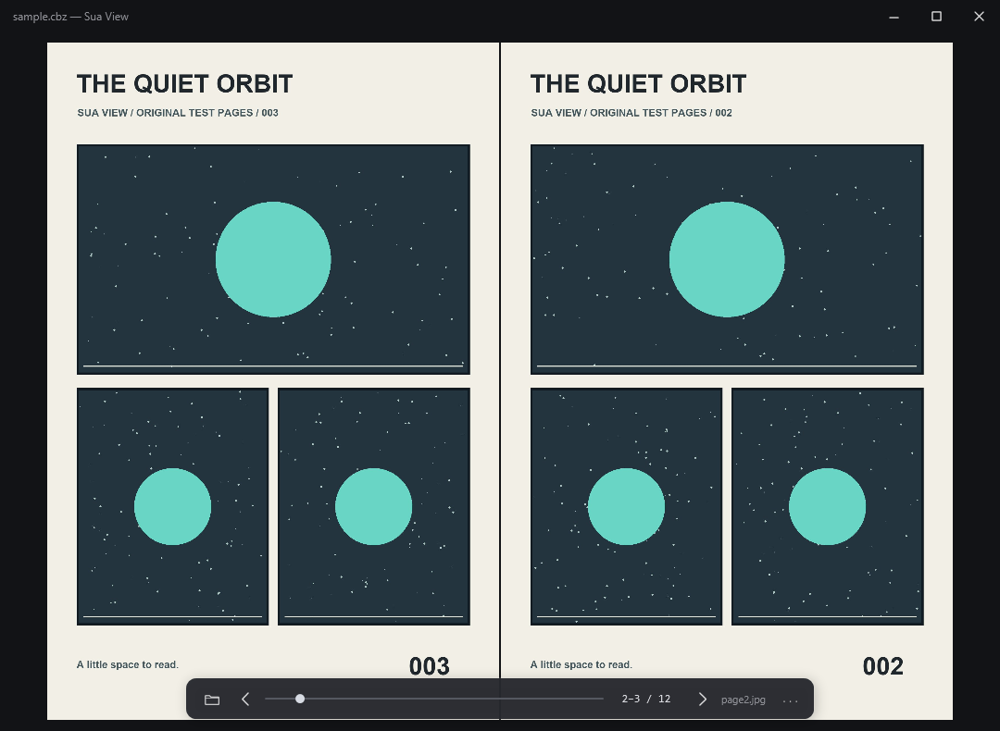
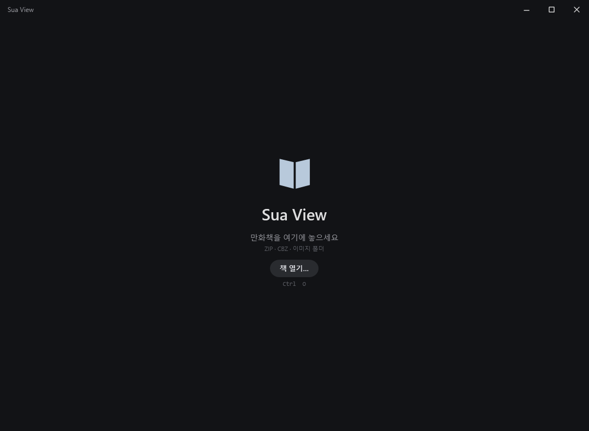
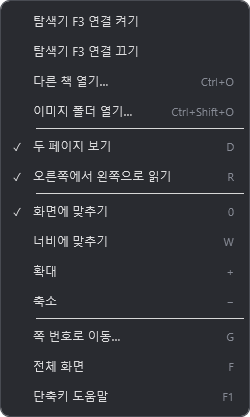

# Sua View · 수아 뷰

**속도에 모든 걸 건, 작고 가벼운 이미지 뷰어.**

**A small, lightweight image viewer built around speed.**

[한국어](#한국어) · [English](#english) · [Download / 다운로드](https://github.com/izowooi/crispy-app/releases/tag/sua-view-v0.1.0)



## 한국어

### 빠르게 열고, 바로 보기

수아 뷰는 **이미지를 여는 일에 집중한 미니멀한 로컬 뷰어**입니다. 꿀뷰의 빠르고 간단한 사용 경험과 공개된 오픈소스 뷰어들을 참고하며, 설계의 기준을 로딩 속도와 가벼움에 두었습니다. 폴더나 압축 파일을 열고, 이미지를 보고, 다음 장으로 넘기는 흐름을 짧게 만듭니다.

핵심 엔진은 현대적인 언어 **Rust**로 작성했습니다. ZIP/CBZ는 전체를 미리 풀지 않고 페이지 인덱스로 필요한 이미지를 읽습니다. 화면은 macOS의 AppKit과 Windows의 WPF로 구성하며, Electron이나 WebView를 사용하지 않습니다. 파일은 로컬에서 읽고, 계정이나 서버 연결 없이 동작합니다.

**오로지 속도에 모든 걸 걸었습니다.** 빠르게 열고 편하게 보는 경험이 목표입니다. 실제 로딩 시간은 이미지 크기, 압축 방식, 저장장치에 따라 달라집니다.

### 다운로드와 첫 실행

[**공개 릴리스에서 다운로드 →**](https://github.com/izowooi/crispy-app/releases/tag/sua-view-v0.1.0)

| 운영체제 | 받을 파일 | 실행 방법 |
| --- | --- | --- |
| Windows 10/11 x64 | `Sua-View-0.1.0-windows-x64.zip` | **모두 압축 해제**한 뒤 `SuaView.exe` 실행. DLL과 설정 파일을 같은 폴더에 유지하세요. .NET Framework 4.8이 필요합니다. |
| macOS 12 이상 · Apple Silicon | `Sua-View-0.1.0-macOS-arm64.zip` | ZIP을 풀고 `Sua View.app`을 Applications에 복사해 실행하세요. |

Windows 실행 파일은 코드 서명되지 않았으며, macOS 앱은 ad-hoc 서명만 포함하고 Apple 공증은 없습니다. 릴리스의 SHA-256 파일로 다운로드 무결성을 확인할 수 있습니다.

### Windows 메인 화면



**책 열기…** 또는 `Ctrl+O`로 ZIP/CBZ나 이미지 파일을 여세요. 파일·폴더를 창에 끌어놓을 수도 있습니다. 이미지 폴더는 `Ctrl+Shift+O` 또는 우클릭 메뉴의 **이미지 폴더 열기…**로 엽니다.

읽는 동안 하단 조작부는 잠시 뒤 숨겨지고, 마우스를 움직이면 다시 나타납니다. 맨 위의 읽기 화면은 두 쪽 보기와 우→좌 읽기 예시입니다. 스크린샷에 사용한 이미지는 이 프로젝트에서 만든 합성 샘플입니다.

### Windows: 탐색기에서 선택하고 F3

꿀뷰에서 편했던 흐름 그대로, **탐색기에서 폴더나 ZIP을 선택한 뒤 F3으로 바로 엽니다.** 처음 한 번 연결을 켜면 뷰어가 닫혀 있어도 사용할 수 있습니다.

1. ZIP을 계속 사용할 위치에 모두 압축 해제하고 `SuaView.exe`를 실행합니다.
2. SuaView 화면을 **우클릭**하고 **탐색기 F3 연결 켜기**를 선택합니다.
3. Windows 탐색기에서 이미지 폴더 또는 `.zip` / `.cbz` 파일을 선택합니다.
4. **F3**을 누릅니다. 선택한 폴더나 압축 파일이 SuaView에서 열립니다.



메뉴 맨 위 두 항목으로 연결을 켜고 끕니다. 도우미는 **현재 사용자 로그인 시 자동 실행**되며 관리자 권한은 필요 없습니다. 탐색기에서는 F3 검색 기능을 대신하고, 다른 앱의 F3은 유지합니다. Windows 11에서는 현재 활성 탭의 선택 항목을 엽니다. 여러 항목을 선택하면 첫 항목을 사용합니다.

해제하려면 **탐색기 F3 연결 끄기**를 선택하세요. 알림 영역 도우미 메뉴의 **Disable F3 and startup**으로도 해제할 수 있습니다. 앱 폴더를 옮기기 전 연결을 끄고, 새 위치에서 다시 켜세요. 로그인 자동 실행 없이 이번 세션에서만 쓰려면 `SuaViewF3.exe`를 직접 실행하면 됩니다.

### macOS: Finder에서 선택하고 ⇧⌘J

Finder에서 파일이나 폴더를 선택하고 **⇧⌘J**를 누르세요. 서비스 이름은 **Sua View로 열기**입니다. 활성화가 필요하면 **시스템 설정 → 키보드 → 키보드 단축키 → 서비스**에서 해당 서비스를 켭니다. 같은 화면에서 단축키도 바꿀 수 있습니다.

서비스 등록과 소스 설치 방법은 [macOS 사용 가이드](docs/USAGE.md#finder에서-단축키로-열기)를 참고하세요.

### 보는 데 필요한 것만

자연 정렬, 한 쪽·두 쪽 보기, 좌→우·우→좌 읽기, 확대와 화면 맞춤, 전체 화면, 읽던 위치 저장을 제공합니다.

| 조작 | Windows | macOS |
| --- | --- | --- |
| 파일 열기 | `Ctrl+O` | `⌘O` |
| 탐색기 / Finder 선택 항목 열기 | `F3` · 연결 후 | `⇧⌘J` · 서비스 활성화 후 |
| 이전 / 다음 | `←` / `→` · 읽기 방향 적용 | 동일 |
| 다음 / 이전 | `Space` / `Shift+Space` | 동일 |
| 한 쪽 / 두 쪽 | `D` | `D` |
| 읽기 방향 전환 | `R` | `R` |
| 너비 / 화면 맞춤 | `W` / `0` | 동일 |
| 페이지 번호로 이동 | `G` | `G` |
| 전체 화면 / 나가기 | `F` / `Esc` | 동일 |

### 지원 형식

| 입력 | Windows | macOS |
| --- | --- | --- |
| ZIP / CBZ · Stored, Deflate | 지원 | 지원 |
| 이미지 폴더 · 하위 폴더 포함 | 지원 | 지원 |
| JPG, PNG, GIF, BMP, TIFF | 지원 · GIF는 첫 프레임 | OS 디코더 지원 범위 · 애니메이션은 첫 프레임 |
| RAR / CBR, 7z / CB7, TAR / CBT | 미지원 | 시스템 libarchive 지원 범위 |
| WebP, HEIC, AVIF | 미지원 | OS 이미지 디코더 지원 범위 |

PDF와 암호화·분할 압축은 지원하지 않습니다. macOS의 RAR/7z/TAR는 압축 구조에 따라 ZIP과 읽기 속도가 다를 수 있습니다. 자세한 제한과 단축키는 [Windows 가이드](docs/WINDOWS.md)와 [macOS 가이드](docs/USAGE.md)에 정리했습니다.

### 소스에서 빌드

Rust 1.88 이상이 필요합니다. macOS는 Xcode Command Line Tools, Windows는 MSVC C++ Build Tools·Windows SDK·.NET Framework 4.8을 준비하세요. 두 OS 모두 같은 명령으로 현재 OS용 앱을 빌드합니다.

```sh
cd sua-view
cargo run --locked --bin sua-view-build
```

macOS 결과물은 `dist/Sua View.app`, Windows 결과물은 `dist/Sua-View-windows-x64/SuaView.exe`와 배포 ZIP입니다.

[플랫폼 구조](docs/PLATFORMS.md) · [검증 명령](#development-checks) · [MIT 라이선스](../LICENSE)

## English

### Open fast. Get straight to the image.

Sua View is a **minimal local image viewer focused on speed and a small footprint**. Inspired by Honeyview's quick, simple workflow and publicly available open-source viewers, it puts loading speed at the center of its design: open a folder or archive, see the image, turn the page.

The core engine is written in **Rust**. It indexes ZIP/CBZ archives and reads the pages it needs without extracting the entire archive first. The interface uses native AppKit on macOS and WPF on Windows, with no Electron or WebView. Files stay local; no account or server connection is needed.

**Speed is the priority.** The goal is to open quickly and get out of the way. Actual loading time depends on image size, compression and storage.

### Download and launch

[**Download the public release →**](https://github.com/izowooi/crispy-app/releases/tag/sua-view-v0.1.0)

| Platform | Download | Start |
| --- | --- | --- |
| Windows 10/11 x64 | `Sua-View-0.1.0-windows-x64.zip` | **Extract everything**, then launch `SuaView.exe`. Keep the DLL and configuration file beside it. Requires .NET Framework 4.8. |
| macOS 12+ · Apple Silicon | `Sua-View-0.1.0-macOS-arm64.zip` | Extract and copy `Sua View.app` to Applications. |

Windows binaries are unsigned. The macOS app is ad-hoc signed and is not notarized by Apple. SHA-256 files are available with the release.

### Windows home and reading screens

The [home screenshot above](#windows-메인-화면) shows the **책 열기…** (Open book) button. Use it or `Ctrl+O` to open an archive or image. Drag and drop a file or folder into the window, or use `Ctrl+Shift+O` to choose an image folder.

The opening screenshot shows two-page, right-to-left reading. Controls fade away while reading and return when you move the mouse. All pictured pages are original synthetic samples created by this project. These screenshots show the current Windows UI in Korean.

### Windows: select in Explorer, press F3

Enable the shortcut once to open selected folders and ZIP/CBZ files, even when the viewer is closed.

1. Extract the release into a folder you plan to keep, then launch `SuaView.exe`.
2. **Right-click inside SuaView** and choose **탐색기 F3 연결 켜기** (Enable Explorer F3).
3. Select an image folder, `.zip` or `.cbz` file in Windows File Explorer.
4. Press **F3** to open it in SuaView.


The first two menu items enable and disable the connection. The helper starts automatically when **the current user signs in**, without administrator privileges. It replaces Explorer's F3 search shortcut while leaving F3 in other apps unchanged. On Windows 11 it uses the active Explorer tab. If multiple items are selected, it opens the first one.

Choose **탐색기 F3 연결 끄기** (Disable Explorer F3), or **Disable F3 and startup** from the helper's notification-area menu, to remove the connection and automatic startup. Disable it before moving the app folder, then enable it again from the new location. For this session only, run `SuaViewF3.exe` directly without enabling automatic startup.

### macOS: select in Finder, press ⇧⌘J

Select a file or folder in Finder and press **⇧⌘J**. The service is called **Sua View로 열기** (Open with Sua View). If needed, enable it under **System Settings → Keyboard → Keyboard Shortcuts → Services**. You can change the shortcut there too. See the [macOS guide](docs/USAGE.md#finder에서-단축키로-열기) for service registration and source installation.

### Reading essentials

Natural file ordering, single-page and two-page views, left-to-right and right-to-left reading, zoom, fit, fullscreen and saved reading positions.

| Action | Windows | macOS |
| --- | --- | --- |
| Open file | `Ctrl+O` | `⌘O` |
| Open selection from Explorer / Finder | `F3` after setup | `⇧⌘J` after enabling the service |
| Previous / next | `←` / `→`, follows reading direction | Same |
| Next / previous | `Space` / `Shift+Space` | Same |
| Single / two pages | `D` | `D` |
| Switch reading direction | `R` | `R` |
| Fit width / fit screen | `W` / `0` | Same |
| Go to page | `G` | `G` |
| Fullscreen / exit | `F` / `Esc` | Same |

### Supported formats

| Input | Windows | macOS |
| --- | --- | --- |
| ZIP / CBZ · Stored, Deflate | Supported | Supported |
| Image folders, including subfolders | Supported | Supported |
| JPG, PNG, GIF, BMP, TIFF | Supported; first GIF frame | Subject to OS decoder support; first animation frame |
| RAR / CBR, 7z / CB7, TAR / CBT | Unsupported | Subject to system libarchive support |
| WebP, HEIC, AVIF | Unsupported | Subject to OS image decoder support |

PDF, encrypted archives and multipart archives are unsupported. On macOS, RAR/7z/TAR performance can differ from ZIP depending on archive structure. More details: [Windows guide](docs/WINDOWS.md) · [macOS guide](docs/USAGE.md).

### Build from source

Requires Rust 1.88+. On macOS, install Xcode Command Line Tools. On Windows, install MSVC C++ Build Tools, the Windows SDK and .NET Framework 4.8. Run the same command on either OS to build its native app:

```sh
cd sua-view
cargo run --locked --bin sua-view-build
```

Output: `dist/Sua View.app` on macOS; `dist/Sua-View-windows-x64/SuaView.exe` and a distribution ZIP on Windows. See [platform architecture](docs/PLATFORMS.md) for the Rust core and native UI boundaries.

### Development checks

```sh
cargo test --locked
cargo clippy --locked --all-targets -- -D warnings
cargo fmt --check
```

Licensed under [MIT](../LICENSE). Dependency notices are included in release archives.
